# Creating Sashimi-Style Plots with \`spliceTerrain\`

## Setup

`BiocManager` is recommended for installing the packages required in
this vignette. `BiocManager` handles installation from Bioconductor,
CRAN and GitHub repositories.

``` r

if (!"BiocManager" %in% rownames(installed.packages()))
    install.packages("BiocManager")
pkgs <- c(
    "spliceTerrain", "RNAseqData.HNRNPC.bam.chr14", "EnsDb.Hsapiens.v75",
    "AnnotationFilter", "ensembldb", "GenomicRanges", "scales", "pander",
    "GenomeInfoDb"
)
BiocManager::install(pkgs, update = FALSE)
```

``` r

library(spliceTerrain)
library(RNAseqData.HNRNPC.bam.chr14)
library(EnsDb.Hsapiens.v75)
library(AnnotationFilter)
library(ensembldb)
library(GenomicRanges)
library(scales)
library(pander)
library(GenomeInfoDb)
```

## Quick start

At a minimum,
[`spliceTerrain()`](https://baerlachlan.github.io/spliceTerrain/reference/spliceTerrain-methods.md)
needs BAM file paths and a genomic interval. Here we use BAM files from
`RNAseqData.HNRNPC.bam.chr14`, selecting one HNRNPC knockdown sample and
one control sample from the study by Zarnack et al. (Zarnack et al.
2013) (ArrayExpress accession E-MTAB-1147). The region can be supplied
as a single character string.

``` r

bams <- RNAseqData.HNRNPC.bam.chr14_BAMFILES[c(7, 1)]
region <- "chr14:70,233,810-70,238,690"

spliceTerrain(bam = bams, region = region)
```


## Introduction

Sashimi plots visualise RNA-seq alignments across a genomic interval.
They combine coverage tracks with arcs representing splice junction
support (Katz et al. 2015). `spliceTerrain` reports both coverage and
junction support in fragment-level units. This makes them useful for
inspecting transcript structure, exon usage, alternative splice sites,
intron retention, and differences in junction usage between samples.

### Motivation

`spliceTerrain` was designed to fit into R/Bioconductor workflows.
Candidate regions, exon models, and features of interest are often
already represented as `GRanges` or `GRangesList` objects from
`GenomicRanges` (Lawrence et al. 2013). `spliceTerrain` allows reuse of
these objects for regions, transcript annotation, and highlights
alongside indexed BAM files, within the same R session. For example,
exon models retrieved from an `EnsDb` object can become annotation rows
without first exporting them to an annotation file.

`spliceTerrain` brings these inputs together in a focused,
sample-resolved sashimi workflow. It returns a `patchwork` plot or an
inspectable genomic context. Its genomic summaries and plotting settings
can be edited and replotted.

`spliceTerrain` displays one panel per BAM for visual inspection of
local splicing patterns. It does not perform differential-splicing
testing, estimate event-level PSI, or infer transcript isoforms.

### Related tools

Several established tools support related visualisation tasks:

- **[`Gviz`](https://bioconductor.org/packages/Gviz/)** provides genomic
  tracks, including BAM-backed coverage and sashimi plots (Hahne and
  Ivanek 2016).
- **[`ggbio`](https://bioconductor.org/packages/ggbio/)** provides
  genomic visualisation based on `ggplot2`, with support for
  Bioconductor objects and transcript-based splice summaries (Yin et al.
  2012).
- **[`SpliceWiz`](https://bioconductor.org/packages/SpliceWiz/)**
  provides coverage and sashimi plots within an alternative-splicing
  analysis workflow. Its event-normalised coverage plots offer an
  alternative view of splicing differences, summarising replicates by
  condition rather than relying on individual-sample sashimi plots (Wong
  et al. 2024).
- **[`ggsashimi`](https://github.com/guigolab/ggsashimi)** provides a
  command-line sashimi plotting workflow with sample overlays and
  aggregation (Garrido-Martín et al. 2018).

`spliceTerrain` focuses on sample-resolved sashimi plots within
R/Bioconductor workflows. It is particularly useful when regions and
annotations are already represented as genomic objects and plots need
iterative refinement. It combines:

- **Editable genomic summaries:** inspect or modify coverage, junctions,
  and settings in a returned context, then replot without importing the
  BAM files again.
- **Coverage-aware compression:** preserve selected blocks defined by
  coverage, annotation, and junction anchors while shortening gaps.
  Coverage retained after filtering can preserve regions within
  annotated introns at their original width.
- **Fragment-level support:** count overlapping mates once per covered
  base and once per distinct junction, while retaining mapped
  singletons.
- **Stable local junction fractions:** calculate usage against the
  pre-display junction reference, so hiding arcs does not change the
  remaining percentages.
- **Integrated sample normalisation:** apply supplied library sizes and
  optional normalisation factors consistently to coverage and junction
  support, while retaining raw fragment counts for filtering.

These choices offer specific contrasts with existing workflows. When
compression is enabled, `ggsashimi` uses junction-derived,
length-dependent shrinking, whereas `spliceTerrain` also uses retained
coverage and annotation to define preserved blocks. By default, `Gviz`
and `ggsashimi` count support at the read level, so both mates can
contribute to coverage and junction counts. In contrast, `spliceTerrain`
uses fragment-level counts. `spliceTerrain` displays transcript
annotation alongside observed junction support without assigning that
support to transcript models. This complements the
transcript-model-based summaries provided by `ggbio`’s
`plotSpliceSum()`.

`spliceTerrain` exposes sample normalisation through dedicated
arguments. `Gviz` supports custom transformations that can implement
similar scaling, whereas the `ggsashimi` command-line interface has no
equivalent library-size normalisation option.

Versions compared: [`Gviz`
1.57.4](https://github.com/ivanek/Gviz/tree/482799c06b17), [`ggbio`
1.61.0](https://github.com/bioconductor-source/ggbio/tree/5d6ed36bdeb6),
[`SpliceWiz`
1.15.0](https://github.com/bioconductor-source/SpliceWiz/tree/37fa02b5b70d),
and [`ggsashimi`
1.1.5](https://github.com/guigolab/ggsashimi/tree/v1.1.5).

## Complete guide

The following sections build up aspects of a more complete plot and
introduce the main options available in
[`spliceTerrain()`](https://baerlachlan.github.io/spliceTerrain/reference/spliceTerrain-methods.md).
The examples continue to use the HNRNPC chr14 BAM files from the quick
start.

### Input BAM files and regions

The `bam` argument is a character vector of indexed BAM file paths. If
the vector is named, those names are used as sample labels in the plot.
If it is unnamed, labels are derived from the BAM file names. BAM files
must be indexed for region-restricted import. Index files should be
discoverable by `Rsamtools` using standard same-directory naming,
typically `file.bam.bai`.

``` r

bams <- RNAseqData.HNRNPC.bam.chr14_BAMFILES[c(7, 1)]
names(bams) <- c("HNRNPC knockdown", "Control")
```

The `region` argument can be a character string, a `GRanges`, or a
`GRangesList`. Character regions may use comma-separated coordinates,
such as `"chr14:70,233,810-70,238,690"`. For Bioconductor workflows,
using a `GRanges` object is often more convenient.

Because the example BAM files use UCSC style chromosome names, we also
convert the region to UCSC style before plotting.

``` r

ensDb <- EnsDb.Hsapiens.v75
region <- transcripts(ensDb, filter = TxIdFilter("ENST00000394366"))
seqlevelsStyle(region) <- "UCSC"
region
#> GRanges object with 1 range and 6 metadata columns:
#>                   seqnames            ranges strand |           tx_id     tx_biotype tx_cds_seq_start tx_cds_seq_end         gene_id         tx_name
#>                      <Rle>         <IRanges>  <Rle> |     <character>    <character>        <integer>      <integer>     <character>     <character>
#>   ENST00000394366    chr14 70233810-70238690      + | ENST00000394366 protein_coding         70234874       70238178 ENSG00000100650 ENST00000394366
#>   -------
#>   seqinfo: 1 sequence from hg19 genome
```

If multiple ranges are supplied,
[`spliceTerrain()`](https://baerlachlan.github.io/spliceTerrain/reference/spliceTerrain-methods.md)
reduces them to a single span on one chromosome and uses that span as
the BAM query and plotting window. The span is the smallest continuous
interval containing all supplied ranges: it starts at the lowest start
coordinate and ends at the highest end coordinate.

### Adding transcript annotation

Transcript models can be displayed with the `annotation` argument. This
must be a `GRangesList`, where each list element represents one
transcript or feature group. The names of the list elements are used as
y-axis labels in the annotation panel. When annotation is present, the
final plot contains one panel per BAM file plus one annotation panel.
The relative heights of these panels are controlled with
`panel_heights`, where the final value corresponds to the annotation
panel. Setting `annotated_junctions = TRUE` distinguishes junctions that
exactly match an intron in the supplied annotation with solid arcs,
while unmatched junctions are drawn with dashed arcs. Junction
classification is relative to the supplied annotation, so known
junctions may appear unmatched when only a subset of transcripts is
provided.

For this vignette, the plotting region covers the *SRSF5* gene. We
retrieve exon ranges for the gene and keep a small number of transcripts
so the annotation panel remains readable.

``` r

annotation <- exonsBy(
    ensDb, by = "tx", filter = GeneIdFilter("ENSG00000100650")
)
annotation <- annotation[1:3]
seqlevelsStyle(annotation) <- "UCSC"
```

``` r

spliceTerrain(
    bam = bams,
    region = region,
    annotation = annotation,
    annotated_junctions = TRUE,
    panel_heights = c(2, 2, 1)
)
```

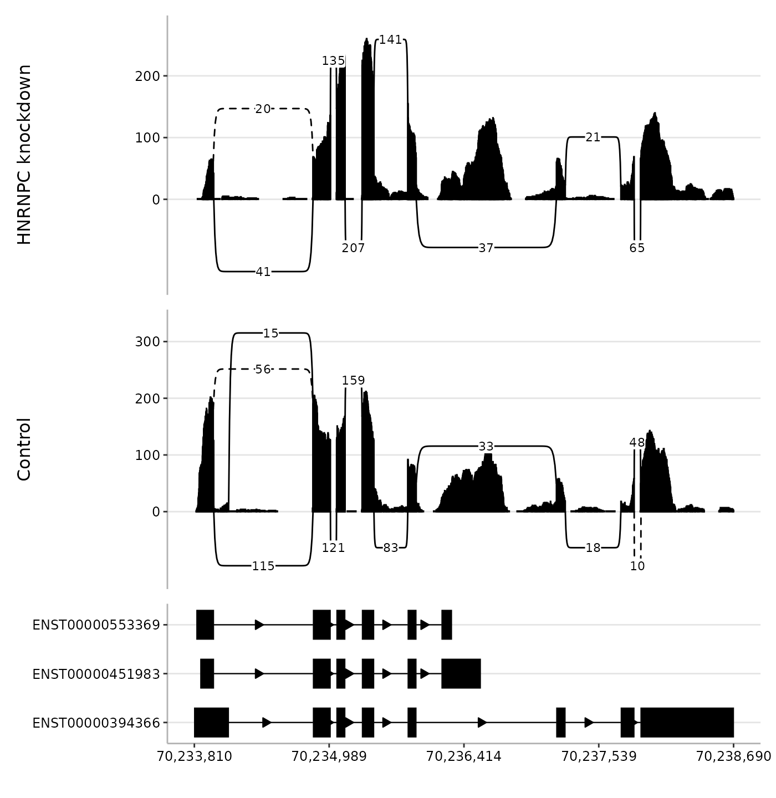

### Styling annotation tracks

Annotation features can be coloured by a metadata column with
`anno_fill_by`. Use `"group"` to colour each transcript or feature group
separately. Specific fill colours can be supplied with
`anno_fill_colours`.

Text labels can be drawn inside annotation features with
`anno_label_by`. The label colour and size are controlled by
`anno_label_colour` and `anno_label_size`. The `min_arrow` argument
controls how wide an annotation intron must be before directional arrows
are drawn.

``` r

spliceTerrain(
    bam = bams,
    region = region,
    annotation = annotation,
    panel_heights = c(2, 2, 1),
    anno_fill_by = "group",
    anno_fill_colours = c(
        ENST00000553369 = "#66C2A5",
        ENST00000394366 = "#8DA0CB",
        ENST00000451983 = "#FC8D62"
    ),
    anno_label_by = "exon_rank",
    anno_label_colour = "black",
    anno_label_size = 2.5,
    min_arrow = 100
)
```

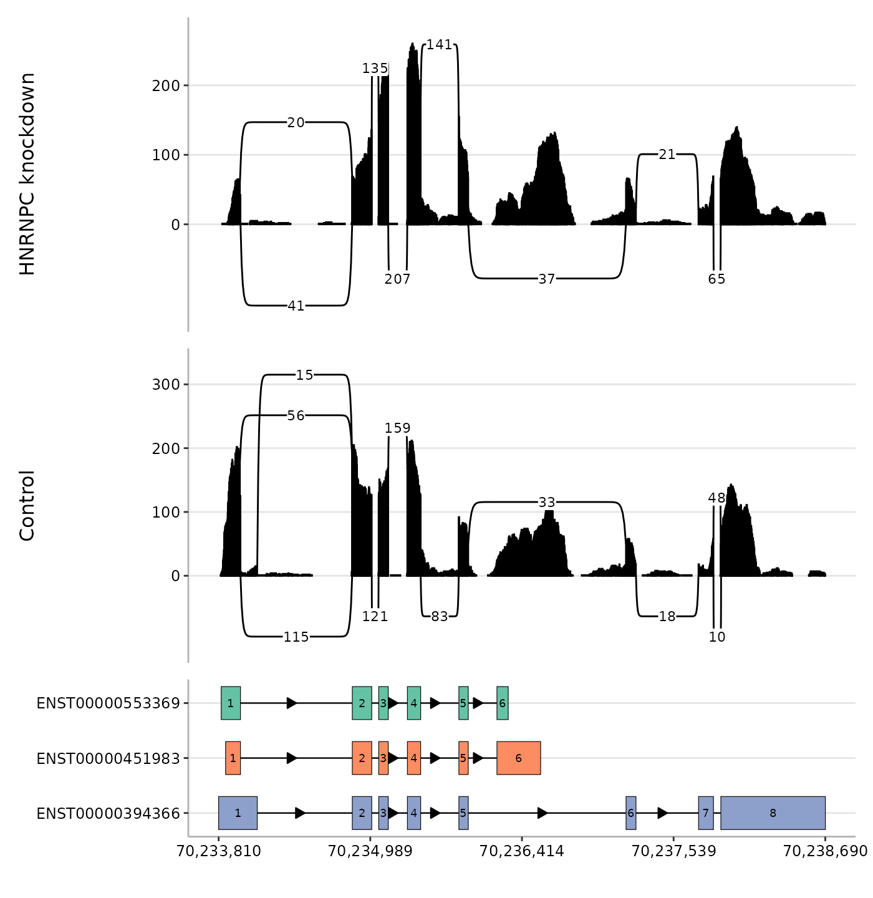

### Highlighting regions of interest

The `highlight` argument marks one or more genomic intervals with shaded
vertical bands. This is useful for drawing attention to a splice site,
variant position, alternative exon, or other feature of interest. The
highlighted interval can be supplied as a character string or as a
`GRanges` object.

``` r

spliceTerrain(
    bam = bams,
    region = region,
    highlight = "chr14:70234854-70234854",
    highlight_colour = "red"
)
```

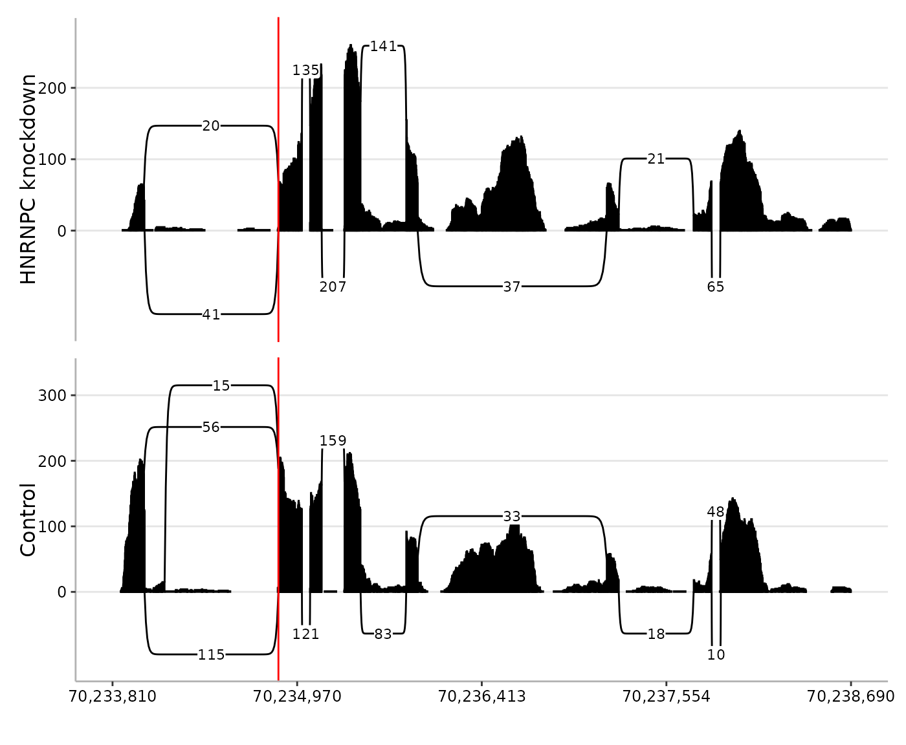

A wider interval can be highlighted with a semi-transparent colour.

``` r

spliceTerrain(
    bam = bams,
    region = region,
    highlight = "chr14:70234056-70234097",
    highlight_colour = scales::alpha("red", 0.2)
)
```

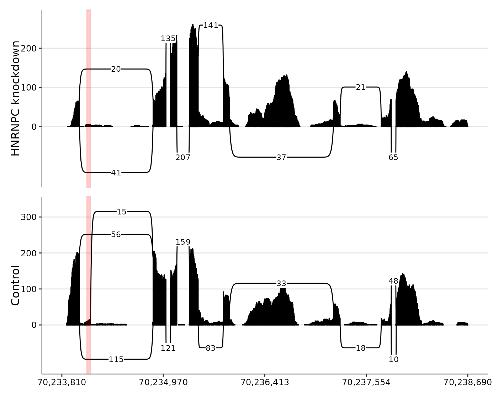

### Local junction-usage labels

The `junction_usage` argument selects junctions by a genomic position or
range and labels their relative fragment support within each sample.
Junctions are selected when either their start or end anchor overlaps
the supplied interval(s). Junction anchors use intronic coordinates: the
start anchor is the first base of the intron, and the end anchor is the
last base of the intron, not the adjacent exonic bases.

**Selecting a single shared splice site gives the cleanest
interpretation.** For junctions sharing a donor or acceptor, the labels
describe their relative support at that site. By default, the junction
count and usage percentage are separated by a new line. Use
`junction_usage_label_sep = " "` to display them together on one line.

``` r

spliceTerrain(
    bam = bams,
    region = region,
    junction_usage = "chr14:70234854-70234854",
    junction_usage_label_sep = " "
)
```


A range can also be supplied, including one covering multiple splice
sites. It defines a combined set of selected junctions; each junction
enters the denominator once, even if both anchors or overlapping
intervals select it.

``` r

spliceTerrain(
    bam = bams,
    region = region,
    junction_usage = "chr14:70234098-70234854"
)
```


For each sample, the percentage is the junction’s raw fragment support
divided by the summed support of all selected, eligible imported
junctions. This is calculated after import, MAPQ, and strand filtering,
but before `min_junction_reads` filtering or plotting-window exclusion.
An alternative junction remains in the denominator when its arc is
hidden. For example, supports of 90 and 9 give 90.9% and 9.1%; hiding
the second arc with a threshold of 10 leaves the first label at 90.9%,
not 100%. Visible percentages therefore need not sum to 100%.
Library-size normalisation does not change the fractions. The reference
is conditional on the imported data: changing the query region, MAPQ
threshold, or strand selection can change the available evidence.

#### Why this is not event-level PSI

Consider a cassette exon between an upstream and a downstream exon. In a
simplified example, 50 inclusion fragments support both inclusion
junctions, and 50 skipping fragments support the direct skipping
junction. A range selecting all three junctions gives the following
junction-usage labels:

``` r

cassette <- data.frame(
    Junction = c("Upstream inclusion", "Downstream inclusion", "Skipping"),
    Fragments = c(50L, 50L, 50L)
)
cassette[["Junction usage (%)"]] <- round(
    100 * cassette$Fragments / sum(cassette$Fragments), 1
)
pander(cassette)
```

|       Junction       | Fragments | Junction usage (%) |
|:--------------------:|:---------:|:------------------:|
|  Upstream inclusion  |    50     |        33.3        |
| Downstream inclusion |    50     |        33.3        |
|       Skipping       |    50     |        33.3        |

The denominator is 150 units of junction support, so each label is
33.3%. There are only 100 fragments in this constructed example, with a
known exon inclusion fraction of 50%: each inclusion fragment supports
two junctions. Thus the 33.3% labels are not estimates of the cassette
exon’s inclusion. Selecting one shared donor or acceptor instead
compares one inclusion junction with the skipping junction and gives 50%
for each in this example. Ranges remain useful for inspecting broader
patterns, but their combined junction fractions should not be
interpreted as general event-level percent spliced in (PSI) or
transcript-isoform proportions.

### Filtering signal

Three arguments control how much signal is imported and displayed.
`min_mapq` filters alignments by mapping quality during BAM import.
`min_coverage` filters positions by per-base fragment coverage before
plotting. `min_junction_reads` sets the minimum fragment support
required to display a junction arc. Both mates supporting the same
junction contribute one count. Both thresholds are applied to raw
fragment counts before library-size normalisation. The latter two
arguments also accept percentage strings such as `"10%"`. Percentage
thresholds are calculated separately for each BAM relative to its
maximum raw coverage or junction count within the plotting region. When
supplying one threshold per BAM, whole-number counts and percentages can
be mixed in a character vector.

``` r

spliceTerrain(
    bam = bams,
    region = region,
    min_mapq = 10,
    min_coverage = 10,
    min_junction_reads = "10%"
)
```

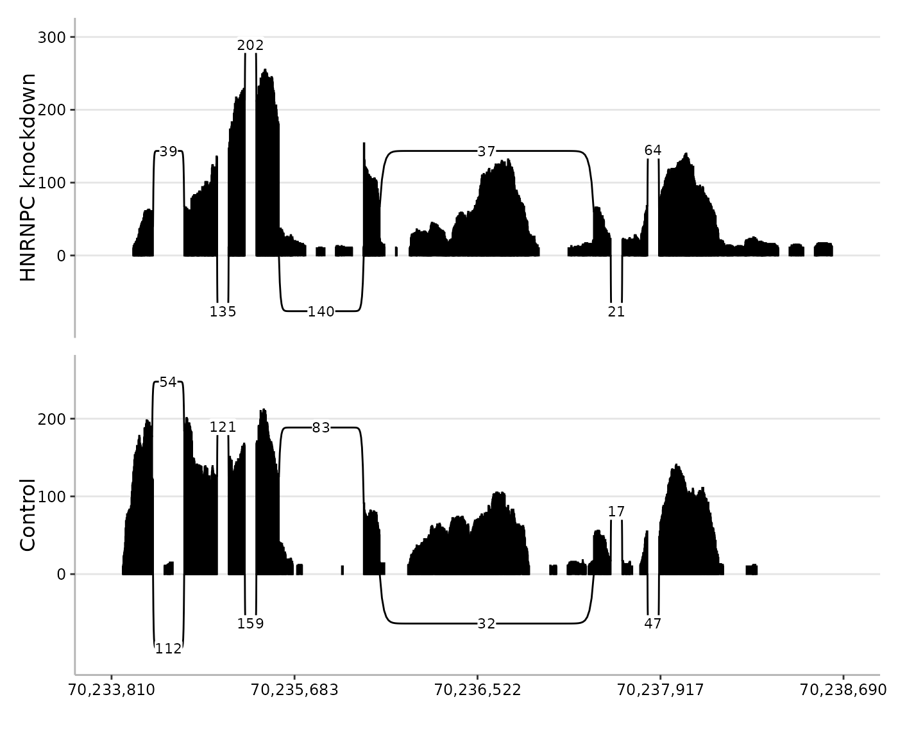

### Stranded RNA-seq data

The `strandedness` argument describes how read strand should be
interpreted. It can be one of `"unstranded"`, `"forward"`, or
`"reverse"`, and can be supplied either as a single value for all BAM
files or one value per BAM file. The example BAM files are unstranded,
so both read orientations contain signal from the transcript.

``` r

spliceTerrain(
    bam = bams,
    region = region,
    strandedness = "unstranded"
)
```

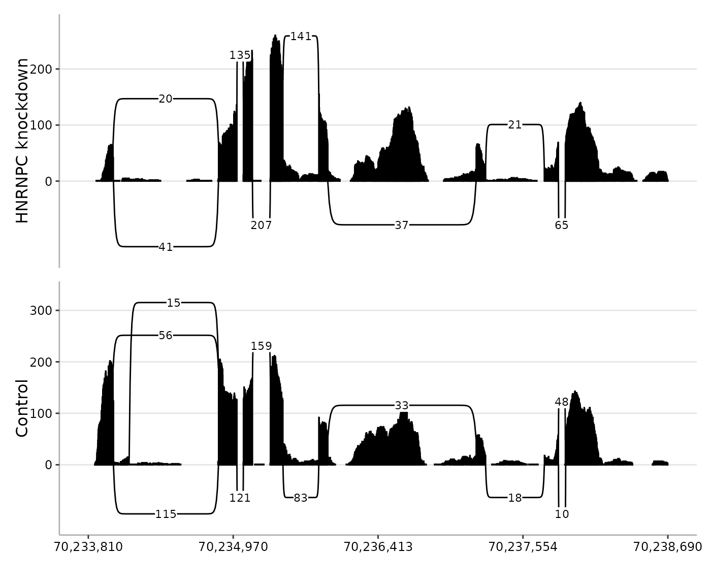

Specifying a stranded protocol for unstranded BAM files filters reads by
strand. As a result, either `"reverse"` or `"forward"` shows only part
of the coverage that is visible when `strandedness = "unstranded"`.

``` r

spliceTerrain(
    bam = bams,
    region = region,
    strandedness = "forward"
)
```

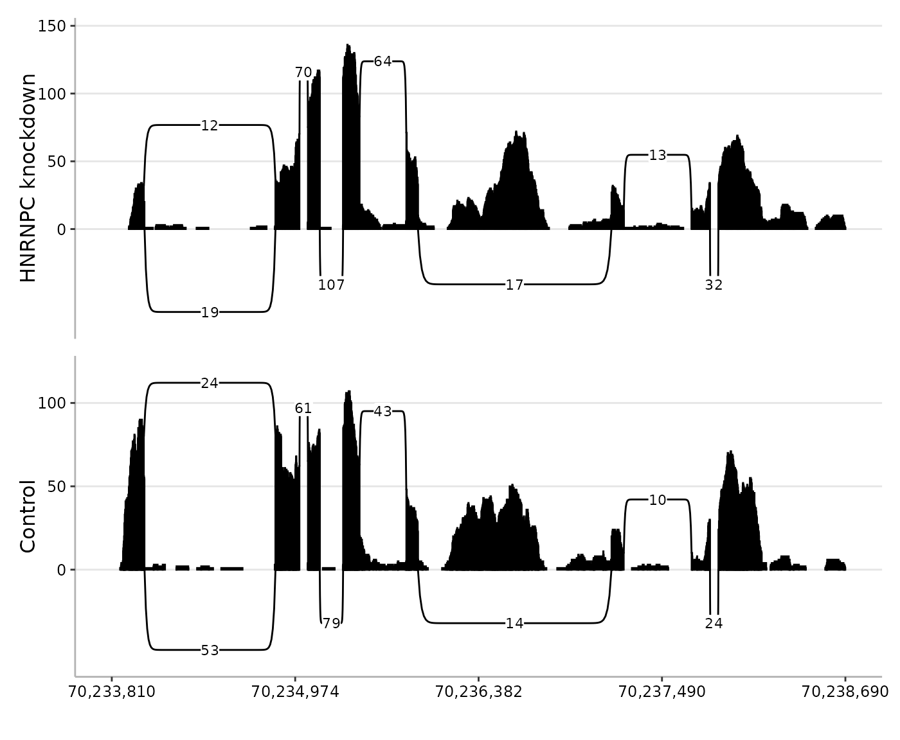

``` r

spliceTerrain(
    bam = bams,
    region = region,
    strandedness = "reverse"
)
```

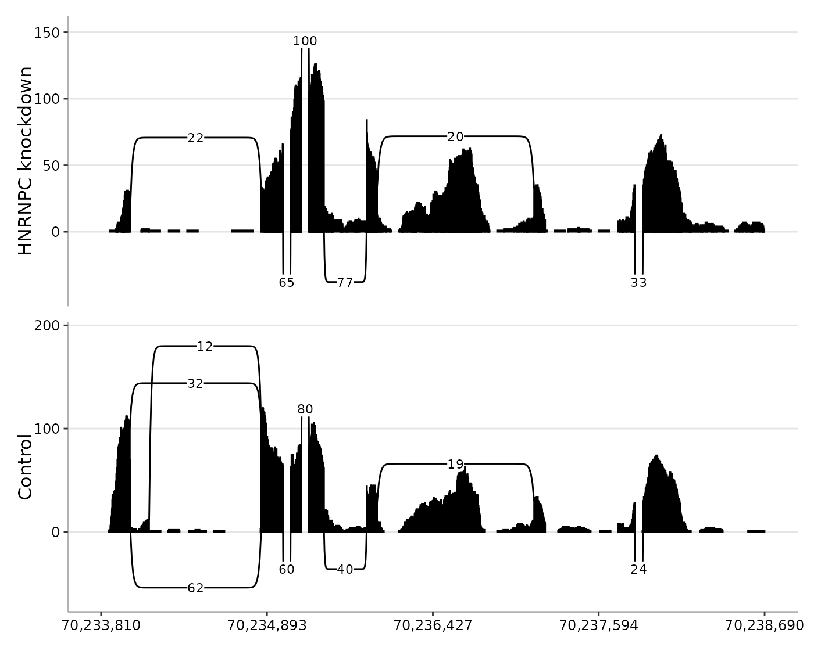

For paired-end BAM files,
[`spliceTerrain()`](https://baerlachlan.github.io/spliceTerrain/reference/spliceTerrain-methods.md)
detects paired-end status from the BAM alignment flags and imports
alignments accordingly. Mapped reads are retained even when their mates
are unmapped. Read-one/read-two flags determine strand interpretation
for both complete pairs and singletons. Unmapped, secondary,
supplementary, and below-`min_mapq` alignments are excluded. If `region`
specifies a strand and `strandedness` is not `"unstranded"`, alignments
are restricted to the resolved region strand.

Coverage and junction support are fragment-level summaries. Each
imported mate group, mapped singleton, or single-end read is one
fragment. Coverage uses the union of each fragment’s aligned blocks.
Overlapping mates contribute at most one count per covered position.
Introns and unsequenced gaps between mates remain uncovered. Each
fragment supports a distinct junction at most once, even if both mates
cross it.

### Normalising between samples

When samples have different sequencing depths, coverage and junction
counts can be normalised with `lib_size`. Supply full-library sizes in
fragment units before restriction to the plotting region: one per pair
or mapped singleton, or one per read for single-end data. Additional
normalisation factors, such as trimmed mean of M-values (TMM) factors
(Robinson and Oshlack 2010) estimated with `edgeR`, can be supplied with
`norm_factors`. The effective library size is calculated as
`lib_size * norm_factors`.

By default, counts are normalised to the median effective library size.
Use `normalise_to` to set the target explicitly. The `common_y` argument
is useful when comparing samples because it puts sample panels on the
same y-axis scale.

``` r

spliceTerrain(
    bam = bams,
    region = region,
    lib_size = c(40e6, 55e6),
    norm_factors = c(0.95, 1.08),
    normalise_to = 50e6,
    common_y = TRUE
)
```

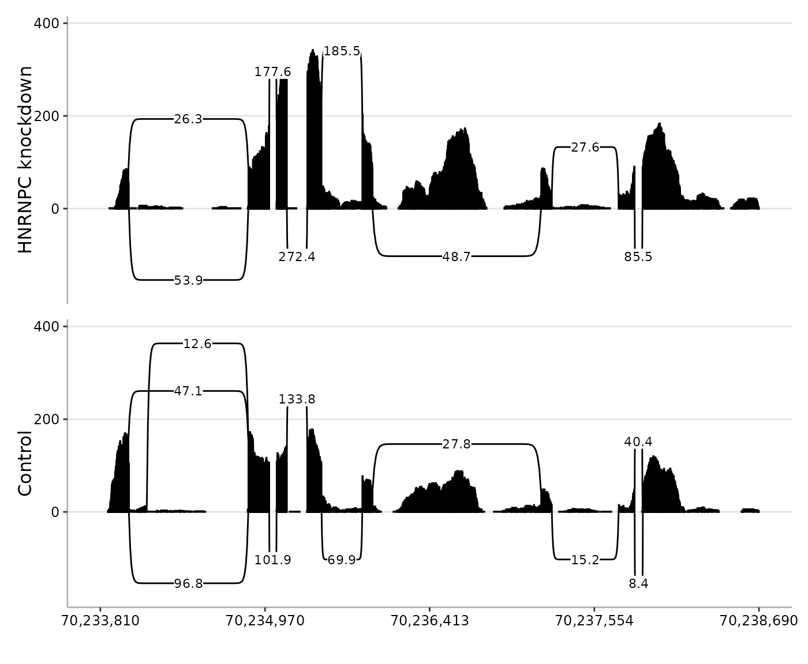

### Compressed genomic layouts

By default, `compress_introns = TRUE` compacts large uninformative gaps
so the plot focuses on observed signal. The `intron_width` argument
controls the approximate width of compacted introns in plot space. The
map is built jointly from retained coverage across samples, annotations,
and junction/selection anchors. Retained blocks keep their widths; gaps
between them receive the chosen width. Consequently, retained intronic
coverage or an unannotated covered exon remains part of the displayed
signal rather than being compressed simply because it lies inside an
annotated intron. Changing coverage filters can change the retained
blocks and their map.

``` r

spliceTerrain(
    bam = bams,
    region = region,
    compress_introns = TRUE,
    intron_width = 500
)
```

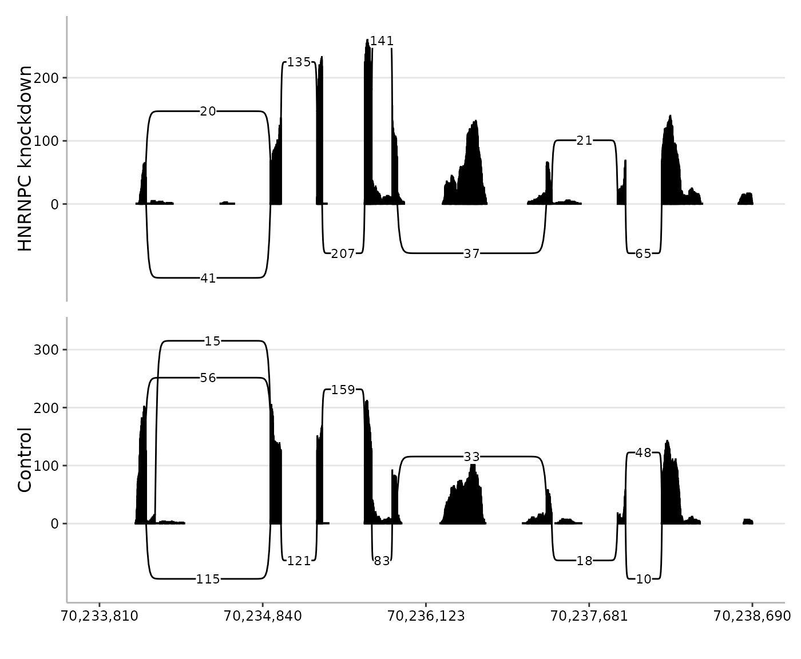

If exact genomic distances are more important than compact display,
intron compression can be disabled.

``` r

spliceTerrain(
    bam = bams,
    region = region,
    compress_introns = FALSE
)
```

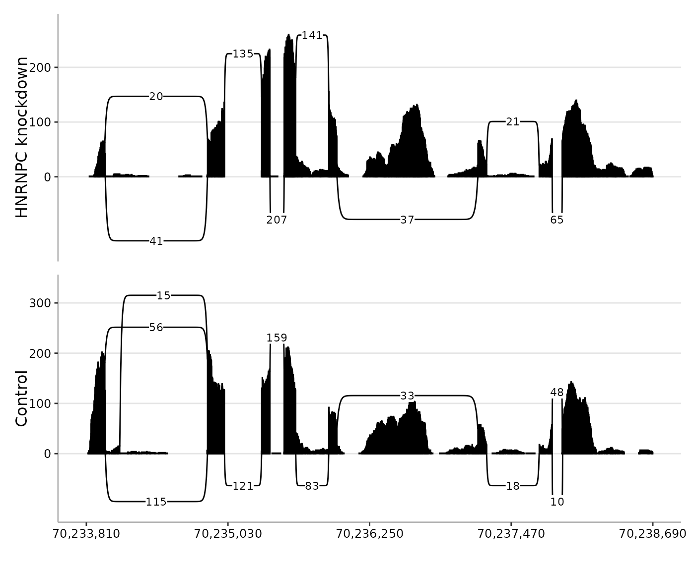

### Junction arc display

Junction arcs can be tuned with `arc_height`, `arc_side`, and
`arc_scale`. Increasing `arc_height` gives stacked arcs more vertical
separation. The `arc_side` argument controls whether arcs are drawn
above, below, or on both sides of the coverage track. With
`arc_scale = TRUE`, arc width scales with filtered fragment support.
Junction label size is controlled with `junc_text_size`.

``` r

spliceTerrain(
    bam = bams,
    region = region,
    junction_usage = "chr14:70234854-70234854",
    arc_height = 2,
    arc_side = "above",
    arc_scale = TRUE,
    junc_text_size = 2.5
)
```

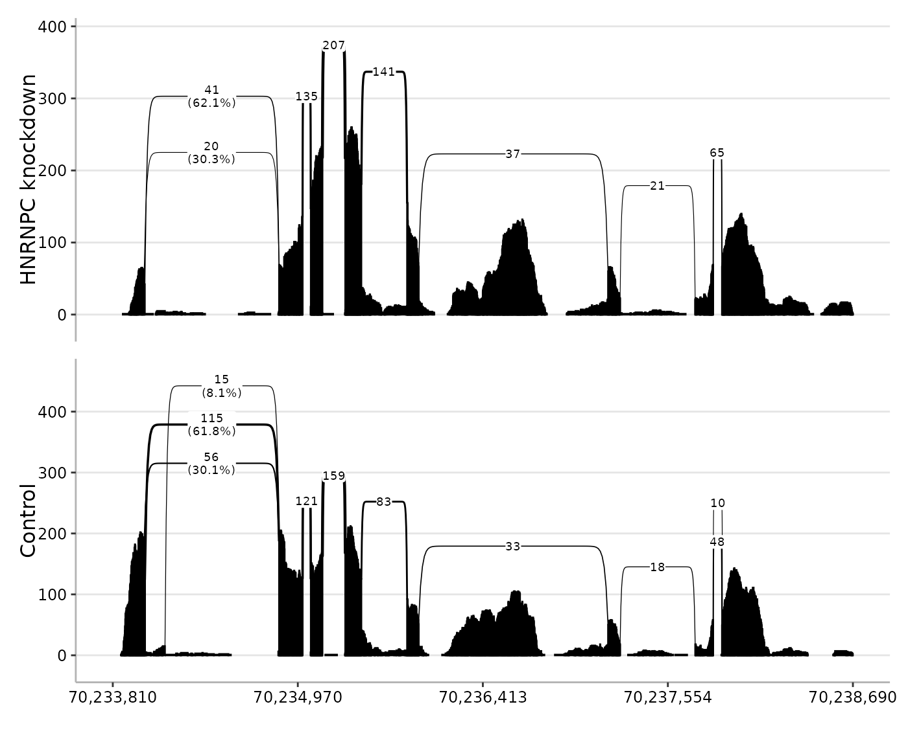

### Sample colours and panel layout

The `colours` argument controls the colours used for sample coverage and
junction arcs. It can be a single colour used for all samples or one
colour per BAM file.

Axis text sizes can be adjusted with `axis_title_size` and
`axis_text_size`.

``` r

spliceTerrain(
    bam = bams,
    region = region,
    annotation = annotation,
    colours = c("darkblue", "darkred"),
    panel_heights = c(2, 2, 1),
    axis_title_size = 20,
    axis_text_size = 12
)
```

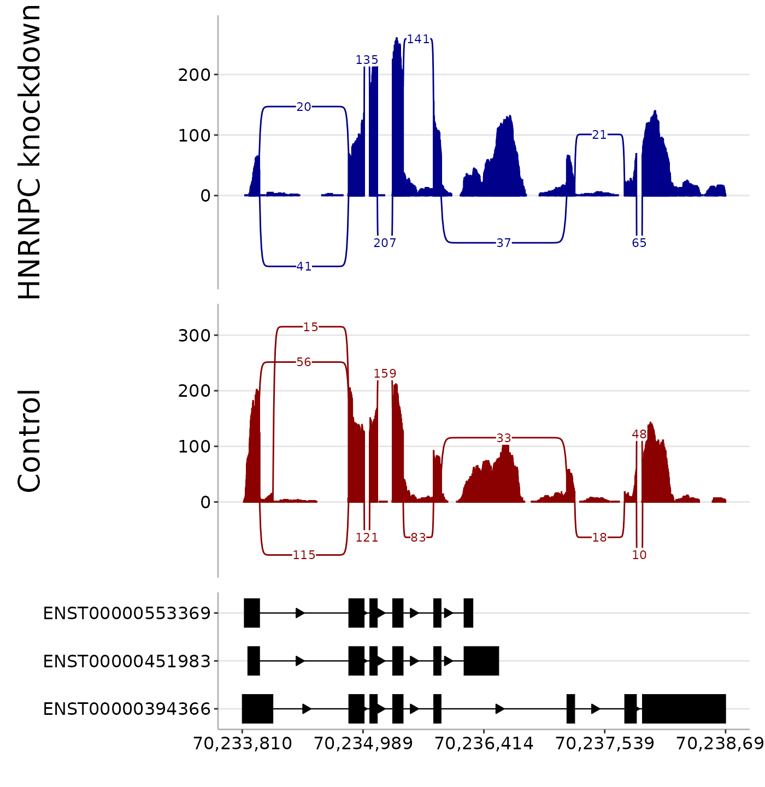

### Returning and reusing plot data

Most users can work directly with the final plot returned by
[`spliceTerrain()`](https://baerlachlan.github.io/spliceTerrain/reference/spliceTerrain-methods.md).
For advanced workflows, set `return_ctx = TRUE` to return the processed
context instead. This contains validated settings, imported alignments,
summarised coverage, junction counts, annotation, and overlays. The
`gal` field contains one alignment object per sample: `GAlignments` for
single-end BAMs or `GAlignmentsList` for paired-end BAMs. The paired-end
list groups imported mates and includes mapped singleton reads. The
`cov` and `juncs` fields contain fragment summaries: `coverage_raw`
holds unnormalised fragment counts and `coverage` holds the plotting
values after any library-size normalisation. The `juncs_all` field
retains eligible junction summaries on the plotting chromosome before
display filtering or clipping, including out-of-window junctions from
imported alignments. It provides a stable reference for the
`usage_fraction` column in `juncs`. That column is on the 0–1 scale,
with `NA` for unselected junctions or an undefined percentage. All
coordinate-bearing fields use genomic coordinates; compressed plot
coordinates are generated internally only when the context is plotted.

The context also supports programmatic inspection, including AI-assisted
workflows. Scripts or AI agents working within an R session can inspect
coverage and junction summaries, check the values underlying plotted
labels, and modify annotations or plotting settings before redrawing the
figure. This provides access to the data behind the visualisation
without requiring those values to be inferred from the plot image.

``` r

ctx <- spliceTerrain(
    bam = bams,
    region = region,
    annotation = annotation,
    min_junction_reads = 1,
    panel_heights = c(2, 2, 1),
    min_arrow = 100,
    return_ctx = TRUE
)

names(ctx)
#>  [1] "bam"                      "region"                   "annotation"               "junction_usage"           "junction_usage_label_sep" "highlight"                "strandedness"             "min_mapq"                 "min_coverage"             "min_junction_reads"       "lib_size"                 "norm_factors"             "normalise_to"             "compress_introns"         "intron_width"             "min_arrow"                "common_y"                 "arc_height"               "arc_side"                 "arc_scale"                "colours"                  "highlight_colour"         "anno_fill_by"             "anno_fill_colours"        "anno_label_by"            "anno_label_colour"        "anno_label_size"          "junc_text_size"           "panel_heights"            "axis_title_size"          "axis_text_size"           "annotated_junctions"      "gal"                      "cov"                      "juncs"                    "juncs_all"
```

The context can be passed back with the `ctx` argument to redraw the
plot without re-importing BAM files or recalculating coverage and
junctions. For example, the annotation can be used to retain only
coverage overlapping annotated exons and junctions that exactly match
annotated introns.

``` r

ctx$cov <- ctx$cov[overlapsAny(ctx$cov, ctx$annotation)]
ctx$juncs <- ctx$juncs[ctx$juncs$annotation_match]
spliceTerrain(ctx = ctx)
```

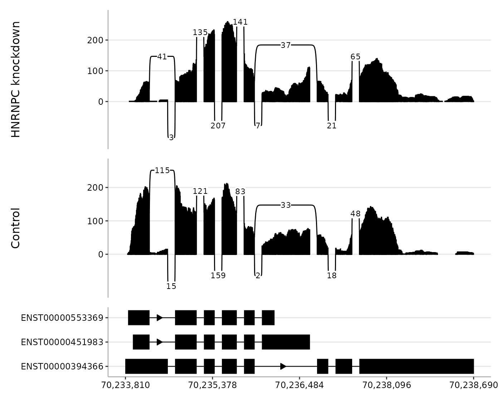

The `annotation_match` field records whether each junction exactly
matches an intron implied by the supplied annotation. Plotting settings
can also be changed directly, for example with
`ctx$colours <- c("darkblue", "darkred")`. Settings that control BAM
import, filtering, or normalisation are not reapplied when a context is
replotted because its coverage and junctions are already processed.

Filtering `ctx$juncs` changes which arcs are displayed without changing
the usage denominator. Changing `ctx$junction_usage` to another
`GRanges` selection recalculates the fractions from `ctx$juncs_all` when
plotting. If you intend to change the reference evidence itself, edit
`ctx$juncs_all`, retaining one row per sample/junction.

## Session information

``` r

sessionInfo() |>
    pander()
```

**R Under development (unstable) (2026-10-13 r90668)**

**Platform:** x86_64-pc-linux-gnu

**locale:** *LC_CTYPE=C.UTF-8*, *LC_NUMERIC=C*, *LC_TIME=C.UTF-8*,
*LC_COLLATE=C.UTF-8*, *LC_MONETARY=C.UTF-8*, *LC_MESSAGES=C.UTF-8*,
*LC_PAPER=C.UTF-8*, *LC_NAME=C*, *LC_ADDRESS=C*, *LC_TELEPHONE=C*,
*LC_MEASUREMENT=C.UTF-8* and *LC_IDENTIFICATION=C*

**attached base packages:** *stats4*, *stats*, *graphics*, *grDevices*,
*utils*, *datasets*, *methods* and *base*

**other attached packages:** *GenomeInfoDb(v.1.48.0)*,
*pander(v.0.6.6)*, *scales(v.1.4.0)*, *EnsDb.Hsapiens.v75(v.2.99.0)*,
*ensembldb(v.2.36.1)*, *AnnotationFilter(v.1.36.0)*,
*GenomicFeatures(v.1.64.0)*, *AnnotationDbi(v.1.74.0)*,
*Biobase(v.2.72.0)*, *GenomicRanges(v.1.64.0)*, *Seqinfo(v.1.2.0)*,
*IRanges(v.2.46.0)*, *S4Vectors(v.0.50.3)*, *BiocGenerics(v.0.58.1)*,
*generics(v.0.1.4)*, *RNAseqData.HNRNPC.bam.chr14(v.0.50.0)*,
*spliceTerrain(v.0.99.0)* and *BiocStyle(v.2.40.0)*

**loaded via a namespace (and not attached):** *tidyselect(v.1.2.1)*,
*dplyr(v.1.2.1)*, *farver(v.2.1.2)*, *blob(v.1.3.0)*,
*Biostrings(v.2.80.2)*, *S7(v.0.2.2)*, *bitops(v.1.1-0)*,
*lazyeval(v.0.2.3)*, *fastmap(v.1.2.0)*, *RCurl(v.1.98-1.20)*,
*GenomicAlignments(v.1.48.0)*, *XML(v.3.99-0.25)*, *digest(v.0.6.39)*,
*lifecycle(v.1.0.5)*, *ProtGenerics(v.1.44.0)*, *KEGGREST(v.1.52.2)*,
*RSQLite(v.3.53.3)*, *magrittr(v.2.0.5)*, *compiler(v.4.7.0)*,
*rlang(v.1.3.0)*, *sass(v.0.4.10)*, *tools(v.4.7.0)*, *yaml(v.2.3.12)*,
*rtracklayer(v.1.72.0)*, *knitr(v.1.52)*, *labeling(v.0.4.3)*,
*S4Arrays(v.1.12.1)*, *htmlwidgets(v.1.6.4)*, *bit(v.4.6.0)*,
*curl(v.8.1.0)*, *DelayedArray(v.0.38.2)*, *RColorBrewer(v.1.1-3)*,
*abind(v.1.4-8)*, *BiocParallel(v.1.46.0)*, *withr(v.3.0.3)*,
*desc(v.1.4.3)*, *grid(v.4.7.0)*, *ggplot2(v.4.0.3)*,
*SummarizedExperiment(v.1.42.0)*, *cli(v.3.6.6)*, *rmarkdown(v.2.32)*,
*crayon(v.1.5.3)*, *ragg(v.1.5.2)*, *otel(v.0.2.0)*, *httr(v.1.4.9)*,
*rjson(v.0.2.23)*, *DBI(v.1.3.0)*, *cachem(v.1.1.0)*,
*parallel(v.4.7.0)*, *BiocManager(v.1.30.27)*, *XVector(v.0.52.0)*,
*restfulr(v.0.0.17)*, *matrixStats(v.1.5.0)*, *vctrs(v.0.7.3)*,
*Matrix(v.1.7-6)*, *jsonlite(v.2.0.0)*, *bookdown(v.0.48)*,
*patchwork(v.1.3.2)*, *bit64(v.4.8.6)*, *systemfonts(v.1.3.2)*,
*jquerylib(v.0.1.4)*, *glue(v.1.8.1)*, *pkgdown(v.2.2.1)*,
*codetools(v.0.2-20)*, *gtable(v.0.3.6)*, *UCSC.utils(v.1.8.0)*,
*BiocIO(v.1.22.0)*, *tibble(v.3.3.1)*, *pillar(v.1.11.1)*,
*htmltools(v.0.5.9)*, *R6(v.2.6.1)*, *textshaping(v.1.0.5)*,
*evaluate(v.1.0.5)*, *lattice(v.0.23-1)*, *png(v.0.1-9)*,
*Rsamtools(v.2.28.0)*, *cigarillo(v.1.2.1)*, *memoise(v.2.0.1)*,
*bslib(v.0.12.0)*, *Rcpp(v.1.1.2)*, *SparseArray(v.1.12.3)*,
*xfun(v.0.61)*, *fs(v.2.1.0)*, *MatrixGenerics(v.1.24.0)* and
*pkgconfig(v.2.0.3)*

## References

Garrido-Martín, Diego, Emilio Palumbo, Roderic Guigó, and Alessandra
Breschi. 2018. “ggsashimi: Sashimi Plot Revised for Browser- and
Annotation-Independent Splicing Visualization.” *PLOS Computational
Biology* 14 (8): e1006360.
<https://doi.org/10.1371/journal.pcbi.1006360>.

Hahne, Florian, and Robert Ivanek. 2016. “Visualizing Genomic Data Using
Gviz and Bioconductor.” In *Statistical Genomics: Methods and
Protocols*, edited by Ewy Mathé and Sean Davis. Springer New York.
<https://doi.org/10.1007/978-1-4939-3578-9_16>.

Katz, Yarden, Eric T. Wang, Jacob Silterra, et al. 2015. “Quantitative
Visualization of Alternative Exon Expression from RNA-seq Data.”
*Bioinformatics* 31 (14): 2400–2402.
<https://doi.org/10.1093/bioinformatics/btv034>.

Lawrence, Michael, Wolfgang Huber, Hervé Pagès, et al. 2013. “Software
for Computing and Annotating Genomic Ranges.” *PLOS Computational
Biology* 9 (8): e1003118.
<https://doi.org/10.1371/journal.pcbi.1003118>.

Robinson, Mark D., and Alicia Oshlack. 2010. “A Scaling Normalization
Method for Differential Expression Analysis of RNA-seq Data.” *Genome
Biology* 11 (3): R25. <https://doi.org/10.1186/gb-2010-11-3-r25>.

Wong, Alex C. H., Justin J.-L. Wong, John E. J. Rasko, and Ulf Schmitz.
2024. “SpliceWiz: Interactive Analysis and Visualization of Alternative
Splicing in R.” *Briefings in Bioinformatics* 25 (1): bbad468.
<https://doi.org/10.1093/bib/bbad468>.

Yin, Tengfei, Dianne Cook, and Michael Lawrence. 2012. “ggbio: An R
Package for Extending the Grammar of Graphics for Genomic Data.” *Genome
Biology* 13 (8): R77. <https://doi.org/10.1186/gb-2012-13-8-r77>.

Zarnack, Kathi, Julian König, Mojca Tajnik, et al. 2013. “Direct
Competition Between hnRNP C and U2AF65 Protects the Transcriptome from
the Exonization of Alu Elements.” *Cell* 152 (3): 453–66.
<https://doi.org/10.1016/j.cell.2012.12.023>.
